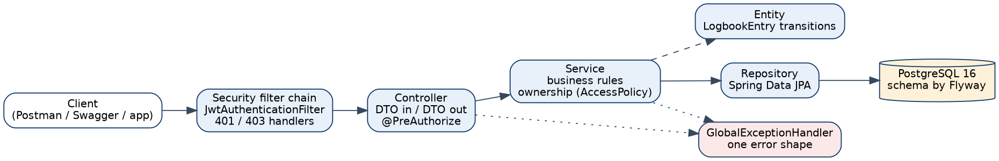
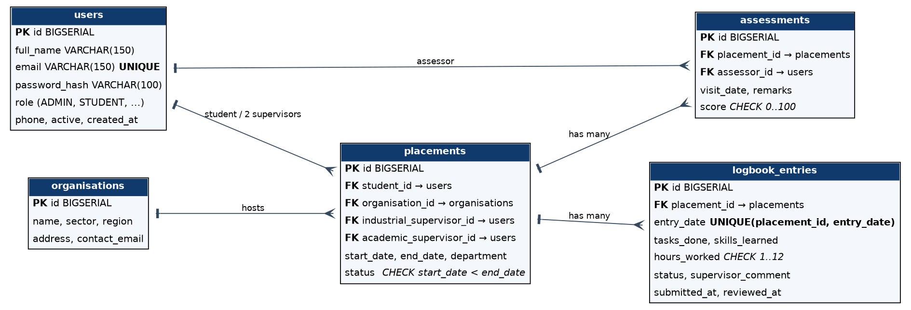

# IPT Tracker

[](https://github.com/<owner>/ipt-tracker-team<NN>/actions/workflows/ci.yml)

IPT Tracker is a REST API that replaces the paper Industrial Practical Training (IPT) logbook used at DIT.
Students record daily logbook entries, the industrial supervisor approves or rejects them with a comment, and the
academic supervisor monitors progress and records a visit assessment. It is built with Spring Boot 3, PostgreSQL,
Flyway and stateless JWT security, and is documented with Swagger UI.

**Live URL:** https://ipt-tracker-team`<NN>`.onrender.com  (Swagger UI: `/swagger-ui.html`)

## Tech stack
Java 21 - Spring Boot 3.5 (Web, Data JPA, Validation, Security) - Maven wrapper - PostgreSQL 16 - Flyway - JWT (jjwt) -
springdoc-openapi - JUnit 5, Mockito, Spring Boot Test, Testcontainers, JaCoCo - Docker, GitHub Actions - Render + Neon.

## Architecture


Request path: **Security filter -> Controller -> Service -> Repository -> PostgreSQL**. Controllers only receive,
delegate and return `ResponseEntity` of DTO records; entities never leave the service layer. Workflow rules live in
`LogbookEntry` (`submit()`, `approve()`, `reject()`); ownership rules live in `AccessPolicy` and the services.



## Run locally
Prerequisites: JDK 21, Docker.
```bash
git clone https://github.com/<owner>/ipt-tracker-team<NN>.git
cd ipt-tracker-team<NN>

# 1. database
docker run --name ipt-db -e POSTGRES_DB=ipt_tracker -e POSTGRES_USER=ipt -e POSTGRES_PASSWORD=ipt \
  -p 5432:5432 -d postgres:16

# 2. secret (Base64, >= 32 bytes) - never commit it
export JWT_SECRET=$(openssl rand -base64 32)

# 3. run (Flyway creates the schema and seed data on startup)
./mvnw spring-boot:run
```
Windows PowerShell: `$env:JWT_SECRET = [Convert]::ToBase64String((1..32 | % {Get-Random -Max 256}))`

Everything in containers: `cp .env.example .env`, edit it, then `docker compose up --build`.

Check: `curl http://localhost:8080/actuator/health` returns `{"status":"UP"}`.

## Environment variables
| Variable | Purpose | Example |
|----------|---------|---------|
| `DB_URL` | JDBC URL | `jdbc:postgresql://localhost:5432/ipt_tracker` |
| `DB_USERNAME` | Database user | `ipt` |
| `DB_PASSWORD` | Database password | `change-me` |
| `JWT_SECRET` | Base64 signing key, >= 32 bytes, **required** | `<output of openssl rand -base64 32>` |
| `JWT_EXPIRATION_MINUTES` | Token lifetime | `60` |
| `PORT` | HTTP port (set by the host) | `8080` |
| `SPRING_PROFILES_ACTIVE` | Use `prod` in production | `prod` |

## Seed accounts (all passwords: `Password123!`)
| Role | Email |
|------|-------|
| ADMIN | admin@ipt.test |
| INDUSTRIAL_SUPERVISOR | industrial@ipt.test |
| ACADEMIC_SUPERVISOR | academic@ipt.test |
| STUDENT (has a demo placement) | student1@ipt.test |
| STUDENT | student2@ipt.test, student3@ipt.test |

## API overview
Interactive docs: `/swagger-ui.html` (press **Authorize**, paste the token from `POST /api/v1/auth/login`).

| Method | Path | Who |
|--------|------|-----|
| POST | `/api/v1/auth/login` | public |
| GET | `/api/v1/auth/me` | any |
| POST/PUT/DELETE | `/api/v1/organisations[/{id}]` | ADMIN |
| GET | `/api/v1/organisations[/{id}]` (filters `region`, `sector`) | any |
| POST/GET | `/api/v1/users` | ADMIN |
| POST | `/api/v1/placements` | ADMIN |
| GET | `/api/v1/placements`, `/api/v1/placements/{id}` | owner roles |
| GET | `/api/v1/placements/{id}/summary` | owner roles |
| POST/GET | `/api/v1/placements/{id}/entries` (filters `status`, `from`, `to`) | STUDENT / owner roles |
| GET/PUT/DELETE | `/api/v1/entries/{id}` | owner roles / STUDENT |
| POST | `/api/v1/entries/{id}/submit` | owning STUDENT |
| POST | `/api/v1/entries/{id}/approve`, `/reject` | assigned INDUSTRIAL_SUPERVISOR |
| GET | `/api/v1/supervisor/pending-entries` | INDUSTRIAL_SUPERVISOR |
| POST/GET | `/api/v1/placements/{id}/assessments` | ACADEMIC_SUPERVISOR / owner roles |

All list endpoints accept `page`, `size` (max 50) and `sort`. All errors use one JSON shape
(`timestamp, status, error, message, path, fieldErrors`). Postman collection and environment: `docs/`.

## Running tests
```bash
./mvnw verify          # unit, controller and Testcontainers integration tests (Docker must be running)
```
Coverage report: `target/site/jacoco/index.html`.

## Known limitations and next steps
- The JWT carries the role, so a deactivated account stays valid until its token expires (add refresh tokens or a check per request).
- `daysWithoutEntry` counts weekdays only and ignores public holidays.
- No rate limiting on login; no email notification on rejection; no PDF export of the summary.
- Next: refresh tokens, login rate limiting, a small React client.
